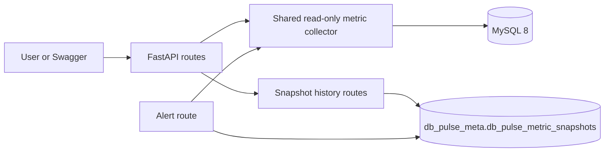

# DB-Pulse

DB-Pulse is a backend-only FastAPI project for MySQL 8 monitoring. It reports selected health metrics, current transactions and lock waits, partition metadata, text-only slow-query suggestions, explicit historical metric snapshots, and read-only health alerts. It does not execute submitted SQL, kill transactions, modify partitions, or change MySQL server settings.

## Architecture

- `app/main.py` creates the FastAPI app, includes routers, and closes the SQLAlchemy pool on shutdown.
- `app/database.py` loads `.env` from the project folder and creates a pooled SQLAlchemy engine using PyMySQL.
- `app/metrics.py` is the shared read-only collector for MySQL connection, uptime, and query counters.
- `app/alerting.py` validates alert thresholds and evaluates rules using current metrics and an existing snapshot.
- `app/models.py` defines DB-Pulse's history table model. It does not create tables automatically.
- `app/routes/` contains the monitoring, lock, analyzer, partition, history, and alert endpoints.
- `tests/` contains API tests and mocked database tests.

## Requirements and Windows setup

Requirements: Windows 10/11, Python 3.10+, and MySQL Server 8.0. In PowerShell, open the DB-Pulse folder and activate its environment:

```powershell
.\.venv\Scripts\Activate.ps1
python -m pip install -r requirements.txt
```

If `.venv` does not exist, create it with `py -m venv .venv`. If PowerShell blocks activation, run `.\.venv\Scripts\python.exe` in place of `python`.

## Database configuration

The app reads `DB_HOST`, `DB_PORT`, `DB_NAME`, `DB_USER`, and `DB_PASSWORD` from `.env` in the project folder. History and alert comparison are restricted to `db_pulse_meta`. For a fresh local setup, copy and edit the example without sharing the password:

```powershell
Copy-Item .env.example .env
notepad .env
```

Set `DB_NAME=db_pulse_meta`. The app's schema metric queries use the selected schema; some server status and transaction metrics are MySQL-wide. `.env` is ignored by Git.

### Initialize the history table

The app does not create tables at startup. In MySQL Workbench connected to `db_pulse_meta`, first check whether `db_pulse_metric_snapshots` already exists. If it does not, run this safe `CREATE TABLE IF NOT EXISTS` statement. It creates only the DB-Pulse table and never drops or alters another table:

```sql
CREATE TABLE IF NOT EXISTS `db_pulse_meta`.`db_pulse_metric_snapshots` (
    `id` BIGINT NOT NULL AUTO_INCREMENT,
    `captured_at` DATETIME(6) NOT NULL COMMENT 'UTC capture time',
    `connected_connections` INT NULL,
    `running_connections` INT NULL,
    `max_connections` INT NULL,
    `connection_utilization_percent` DECIMAL(5,2) NULL,
    `server_uptime_seconds` BIGINT NULL,
    `queries_since_start` BIGINT NULL,
    `questions_since_start` BIGINT NULL,
    `server_metrics_available` BOOLEAN NOT NULL,
    `metrics_warning` VARCHAR(255) NULL,
    PRIMARY KEY (`id`),
    KEY `idx_db_pulse_metric_snapshots_captured_at` (`captured_at`)
) ENGINE=InnoDB DEFAULT CHARSET=utf8mb4;
```

The snapshot API inserts rows only into this table and reads history from this table. The account needs `SELECT` and `INSERT` access on it. Monitoring and alert GET requests do not create snapshots or write to any table.

## Start the API

From the project folder:

```powershell
python -m uvicorn app.main:app --reload
```

The API runs at http://127.0.0.1:8000. Swagger is at **http://127.0.0.1:8000/docs**.

## API endpoints

| Method | Path | Purpose |
| --- | --- | --- |
| GET | `/` | Welcome response |
| GET | `/health` | App process health; does not check MySQL |
| GET | `/monitoring` | Schema and available server metrics; read-only |
| GET | `/locks` | Current visible transactions and lock waits |
| POST | `/slow-queries/analyze` | Explainable text heuristics; does not execute SQL |
| GET | `/partitions` | Partition metadata for the selected schema |
| POST | `/history/snapshots` | Explicitly save one metric snapshot |
| GET | `/history/snapshots?limit=20` | List recent snapshots; `limit` is 1-100 and defaults to 20 |
| GET | `/alerts` | Evaluate current metrics and compare query counters to existing history |

### Alert rules and defaults

`GET /alerts` is read-only. It calls the shared current-metric collector and reads at most the newest history row. It never calls `POST /history/snapshots` or writes a snapshot.

Thresholds can be set in `.env`; the same optional defaults are listed in `.env.example`:

| Environment setting | Default | Rule |
| --- | ---: | --- |
| `DB_PULSE_ALERT_CONNECTION_WARNING_PERCENT` | 75 | Warning when connection utilization is at or above this percent |
| `DB_PULSE_ALERT_CONNECTION_CRITICAL_PERCENT` | 90 | Critical when utilization is at or above this percent; must be greater than warning and at most 100 |
| `DB_PULSE_ALERT_NEAR_MAX_WARNING_REMAINING` | 10 | Warning when this many or fewer connection slots remain |
| `DB_PULSE_ALERT_NEAR_MAX_CRITICAL_REMAINING` | 2 | Critical when this many or fewer slots remain; must be less than the warning value |
| `DB_PULSE_ALERT_QUERY_RATE_WARNING_PER_MINUTE` | 600 | Warning when the interval-average increase in global `Queries` reaches this count per minute |

Connection utilization and low remaining capacity are separate signals, so both can appear at once. When a configured value is invalid or threshold ordering is inconsistent, `/alerts` returns a safe configuration error instead of evaluating with a guessed value.

For query activity, DB-Pulse compares the current cumulative MySQL `Queries` counter with the newest explicit snapshot. It calculates a per-minute average only if the snapshot timestamp is earlier, the counters and uptimes are present, and the server uptime has not moved backward. This is an interval average for the whole MySQL server, not a live rate. With no snapshot, the endpoint returns an informational baseline alert. Counter reset or missing interval data is reported as not comparable, not as a high rate.

Unavailable current counters produce a warning alert; partial counter data produces an informational alert. Metrics that are absent are returned as unavailable and are not replaced with invented values. Database connection failures return a generic `503` response without credentials or raw connection details.

### Example alert response

Values below are examples; current counters and emitted alerts depend on the database and thresholds.

```json
{
  "status": "evaluated",
  "alert_count": 2,
  "history_comparison": "available",
  "thresholds": {
    "connection_warning_percent": 75.0,
    "connection_critical_percent": 90.0,
    "near_max_warning_remaining": 10,
    "near_max_critical_remaining": 2,
    "query_rate_warning_per_minute": 600.0
  },
  "alerts": [
    {
      "code": "CONNECTION_UTILIZATION_HIGH",
      "severity": "warning",
      "title": "MySQL connection utilization is elevated",
      "metric": "connections.utilization_percent",
      "observed_value": 82.5,
      "threshold": 75.0,
      "explanation": "Connection use is above the warning threshold. This is a risk signal, not proof that the server is failing.",
      "suggested_action": "Review connection-pool sizes and whether applications release connections promptly."
    },
    {
      "code": "QUERY_ACTIVITY_INCREASED",
      "severity": "warning",
      "title": "Query activity between snapshots is elevated",
      "metric": "query_activity.queries_per_minute_since_snapshot",
      "observed_value": 700.0,
      "threshold": 600.0,
      "explanation": "MySQL's cumulative Queries counter increased during the saved interval. This is an interval average across the whole server, not an instantaneous rate.",
      "suggested_action": "Review workload changes and use MySQL statement statistics or application logs to identify which clients account for the increase."
    }
  ],
  "read_only": true,
  "snapshot_saved": false
}
```

Each alert has a stable `code`, severity, observed value when known, threshold, explanation, and suggested action. No alerts means no configured rule fired; it does not guarantee that every part of MySQL is healthy.

### Try alerts in Swagger

1. Initialize `db_pulse_metric_snapshots` using the SQL above.
2. Start the API and open **http://127.0.0.1:8000/docs**.
3. Optional: call `POST /history/snapshots` to save a baseline.
4. Call `GET /alerts` to evaluate current counters. Call `POST /history/snapshots` again after a while if you want a real query-counter interval to compare.
5. To try threshold alerts locally, change a `DB_PULSE_ALERT_*` value in `.env`, restart Uvicorn, and call `GET /alerts` again. Keep the warning connection percent lower than critical and near-max warning remaining higher than critical.

Other Swagger examples: `GET /monitoring`, `GET /locks`, `GET /partitions`, and `POST /slow-queries/analyze` with `{"query":"SELECT * FROM users"}`.

## Tests

```powershell
python -m pytest -q
```

Alert and history tests mock database connections, so the automated suite does not need MySQL. A real Swagger check is useful for verifying your local MySQL permissions and history table.

## Limitations and troubleshooting

- Connection counts, uptime, and query counters are server-wide. Cumulative counters are not live rates.
- Alerts are warning signals, not a diagnosis that MySQL is failing. The suggested actions are investigation steps, not automatic fixes.
- Query-counter comparison requires at least one readable snapshot with a comparable uptime and positive time interval. A restart invalidates a direct comparison.
- No scheduler, automatic snapshot collection, retention, or deletion endpoint exists. Snapshots are added only by the explicit POST.
- Approximate table statistics can be stale; lock information is a current view and does not show every historical deadlock.
- **Invalid alert configuration:** check the five `DB_PULSE_ALERT_*` settings above. Connection warning must be below critical; remaining warning must be above critical; query rate must be positive.
- **History comparison unavailable:** initialize the table and confirm the account can read it. Current metric alerts can still be evaluated.
- **Connection refused:** check the Windows `MySQL80` service and `DB_HOST`/`DB_PORT`.
- **History endpoint returns 409:** make sure `DB_NAME=db_pulse_meta`; history and alerts refuse other schemas.
- **Port 8000 is busy:** use `python -m uvicorn app.main:app --reload --port 8001`.

## Interview explanation

"The alert endpoint reuses the same MySQL metric collector as monitoring and compares the current cumulative query counter to an explicitly saved timestamped snapshot. Thresholds are validated, alerts explain the evidence and next action, and the GET request never writes data. A query rate is only calculated over a positive, comparable snapshot interval, so it is not mislabeled as live throughput."

## Beginner setup, architecture, and request flow

DB-Pulse is a small backend project for checking selected MySQL health information from one API. It brings connection and query counters, currently visible lock information, schema partition metadata, safe text-based query suggestions, optional history, and threshold-based alerts into a single Swagger interface.

The request flow is:



`GET /health` checks the application process only. Database-backed routes use the configured SQLAlchemy engine. The alert route reuses the shared metrics and reads history when available. Only an explicit `POST /history/snapshots` adds a history row.

### Prerequisites and reproducible Windows setup

Install Python 3.10 or newer and MySQL Server 8.0. Make sure the local MySQL service is running. From PowerShell:

```powershell
Set-Location 'C:\path\to\DB-Pulse'
py -m venv .venv
.\.venv\Scripts\python.exe -m pip install -r requirements.txt
Copy-Item .env.example .env
notepad .env
```

Use your local MySQL host, port, username, and password in `.env`; set `DB_NAME=db_pulse_meta`. Do not share `.env` or commit it. `.env.example` contains placeholders only. If `.venv` already exists, skip the `py -m venv .venv` line. The requirements include the runtime packages and pytest for project tests.

Initialize the history table only if it is not already present. The SQL shown earlier in this README is scoped to `db_pulse_meta.db_pulse_metric_snapshots` and uses `CREATE TABLE IF NOT EXISTS`; it does not drop or alter anything. Use an account that has permission to read monitoring metadata and `SELECT`/`INSERT` on this table for the corresponding history operations.

Start the API:

```powershell
.\.venv\Scripts\python.exe -m uvicorn app.main:app --reload
```

Open `http://127.0.0.1:8000/docs`. Stop the server with Ctrl+C. To run the full automated suite:

```powershell
.\.venv\Scripts\python.exe -m pytest -q
```

### Endpoint guide and example calls

| Endpoint | Database needed? | What to try in Swagger |
| --- | --- | --- |
| `GET /` | No | Basic project welcome response. |
| `GET /health` | No | Confirms the API process responds; it is not a MySQL health check. |
| `GET /monitoring` | Yes | Reads connection counts, uptime, and available cumulative query counters. |
| `GET /locks` | Yes | Reads currently visible transactions and lock waits; results depend on permissions and activity. |
| `POST /slow-queries/analyze` | No | Submit JSON such as `{"query":"SELECT * FROM users"}`; this is text analysis and does not execute SQL. |
| `GET /partitions` | Yes | Reads partition metadata in the selected schema; empty output can be normal. |
| `POST /history/snapshots` | Yes, with insert permission | Explicitly collects metrics and writes one DB-Pulse history row. Returns HTTP 201 on success. |
| `GET /history/snapshots?limit=5` | Yes, with select permission | Lists recent snapshots; `limit` must be 1–100 and defaults to 20. Empty history returns an empty list. |
| `GET /alerts` | Yes | Evaluates configured rules against current metrics and, when possible, the latest snapshot. It does not save history. |

A successful `GET /health` response has `status` and `project` fields. Monitoring, lock, and partition response values are specific to the connected server and schema, so use the live Swagger response rather than memorized sample values. The alert response example above illustrates the documented field meanings; its numbers are illustrative only. Error responses use HTTP validation errors for invalid inputs, HTTP 409 if history is pointed at a different schema, and safe generic HTTP 503 messages for database connectivity or permission failures.

### Feature limitations

- Health is limited to metrics exposed by the current MySQL account and queries. Missing values remain unavailable.
- Several status counters and connection figures are server-wide. Query counters accumulate since server start; a per-minute comparison is only an average across comparable saved snapshots.
- Lock inspection is a point-in-time view and depends on MySQL visibility permissions. It is not a complete historical deadlock report.
- Partition inspection reports metadata, not partition performance. Table statistics may be approximate or stale.
- Slow-query analysis is a simple text heuristic, not an execution plan or SQL parser. It never submits the supplied statement to MySQL.
- History has explicit saves, no scheduler, retention policy, or cleanup endpoint. The only history writes target the DB-Pulse table.
- Alerts are investigation signals, not proof of failure or an automatic repair system.

### Common troubleshooting

- **Cannot connect / HTTP 503:** verify the `MySQL80` service is running, check `DB_HOST`, `DB_PORT`, `DB_NAME`, and `DB_USER` in the local `.env`, and confirm the user/password locally. Do not paste the password into a terminal transcript or issue report.
- **Access denied / missing lock details:** the MySQL account may need additional read or metadata visibility grants. Grant only the minimum access required, through your normal local MySQL administration process; DB-Pulse does not change grants.
- **History table missing:** run the documented `CREATE TABLE IF NOT EXISTS` statement against `db_pulse_meta`. Check `DB_NAME=db_pulse_meta` and the table's `SELECT`/`INSERT` permissions.
- **HTTP 422:** Swagger input or a query parameter failed validation; read the response's field-level explanation and use an allowed value.
- **HTTP 409 on history/alerts:** these operations intentionally require the selected database to be `db_pulse_meta`.
- **Port conflict:** start with `--port 8001` and open `http://127.0.0.1:8001/docs`.
- **PowerShell blocks activation:** skip activation and use the explicit `.\.venv\Scripts\python.exe -m ...` commands above.

### Interview talking points

- **Why FastAPI?** It provides typed request handling, input validation, generated OpenAPI documentation, and a simple way to organize API routes.
- **How is monitoring safe?** Monitoring paths use read-only queries. The one history write is explicit and limited to DB-Pulse's own table.
- **How are alerts evaluated?** The alert route reuses the shared collector, validates thresholds, and compares cumulative query counters only when history provides a usable interval.
- **How are database failures tested?** Automated tests mock database calls to exercise API success and failure paths without depending on a live MySQL server; live permissions still need a separate local check.
- **What would you add next?** A configurable retention policy and an optional scheduler could be considered after the current manual snapshot flow is well tested and clearly documented.

For a timed walkthrough, see [`DEMO_GUIDE.md`](DEMO_GUIDE.md).

## Advanced operations modules

These additions are independent API modules and do not replace the original heuristic endpoint `POST /slow-queries/analyze`.

### `POST /queries/explain`

Submits JSON such as `{"query":"SELECT id, name FROM users WHERE id = 10"}`. DB-Pulse validates a conservative single-`SELECT` subset and issues MySQL `EXPLAIN` to return optimizer plan rows, including fields like table, access type, possible/selected keys, and estimated rows when MySQL supplies them. It never executes the submitted SELECT and never uses `EXPLAIN ANALYZE`. Empty input, oversize input, comments, multiple statements, non-SELECT, CTEs, qualified identifiers (including other database names), and selected side-effect or unsupported tokens are rejected. This is intentionally conservative and not a complete SQL parser. Plans are estimates, not measured execution behavior. Use a least-privilege MySQL account.

### Schema drift baseline and audit

Before using `POST /schema-drift/baseline`, initialize this DB-Pulse-owned table if absent. It stores versioned schema metadata only; it does not modify monitored application tables:

```sql
CREATE TABLE IF NOT EXISTS `db_pulse_meta`.`db_pulse_schema_baselines` (
    `id` BIGINT NOT NULL AUTO_INCREMENT,
    `created_at` DATETIME(6) NOT NULL,
    `schema_name` VARCHAR(64) NOT NULL,
    `metadata_json` JSON NOT NULL,
    PRIMARY KEY (`id`),
    KEY `idx_db_pulse_schema_baselines_created_at` (`created_at`)
) ENGINE=InnoDB DEFAULT CHARSET=utf8mb4;
```

`POST /schema-drift/baseline` creates the first baseline. Replacing the approved reference requires explicit JSON `{"confirm_replace":true}`; prior versions are retained. `GET /schema-drift/audit` compares the newest baseline with current columns in the configured schema and reports added/removed tables and columns plus changed type, nullability, default, key, or position fields. Defaults for credential-related columns or credential-looking strings are redacted in the saved baseline and response. The baseline table itself is excluded. The service account needs metadata read access and `SELECT`/`INSERT` on this dedicated table. Drift reports structural differences only; they do not identify who changed a schema or whether the change was unauthorized. Audit does not repair anything.

### `GET /pool/status`

Reads supported counters directly from the existing SQLAlchemy pool without opening a connection: pool size, checked-out/in connections, overflow, timeout, and an estimated utilization percentage when a finite capacity is available. `DB_PULSE_POOL_WARNING_PERCENT` defaults to 75; `DB_PULSE_POOL_CRITICAL_PERCENT` defaults to 90 and must be greater than warning (both range 1–100). Unsupported statistics are `null`. SQLAlchemy checkout/checkin events track only active connection-record IDs and aggregate durations, not connection objects or unbounded history; hooks are detached on app shutdown. Pool pressure is a signal, not proof of a connection leak. Existing pool settings are unchanged.

### `POST /backups/verify` (preflight only)

Submit `{"backup_filename":"daily.sql"}`. Configure `DB_PULSE_BACKUP_DIR` to an existing local directory. DB-Pulse accepts only a filename inside that directory, resolves it to reject escapes, allows a non-empty UTF-8 `.sql` file up to `DB_PULSE_BACKUP_MAX_BYTES` (default 100 MiB, maximum 10 GiB), and checks whether the `mysql` client exists. `DB_PULSE_BACKUP_TIMEOUT_SECONDS` defaults to 60 and is reserved for a future restore workflow.

**Restore verification is not implemented.** The endpoint never invokes a subprocess, parses or executes SQL, creates a database, or performs cleanup. A successful preflight means only that basic file checks and the client availability check passed. Untrusted SQL dumps can contain dangerous statements. Any future restore implementation must use a dedicated disposable database, separate restricted credentials, strong isolation, confirmation, bounded execution, and sandbox-only cleanup. No sandbox restore credentials are currently read or required.

### Advanced-module tests and Swagger

The four modules include mocked/pure unit tests so these checks do not require a live MySQL instance or restore. Run all tests with `\.venv\Scripts\python.exe -m pytest -q`, then open `/docs` and try `POST /queries/explain`, `POST /schema-drift/baseline`, `GET /schema-drift/audit`, `GET /pool/status`, and `POST /backups/verify`. Schema drift requires its explicit table initialization; backup preflight requires a configured backup folder and a test SQL file. Do not use an untrusted dump as a demonstration artifact.


### Example responses for the advanced routes

The values below are illustrative response shapes, not claims about the current MySQL instance.

`POST /queries/explain`:

```json
{"plan":[{"id":1,"select_type":"SIMPLE","table":"users","type":"const","possible_keys":"PRIMARY","key":"PRIMARY","rows":1}],"warnings":["Estimated row counts are optimizer estimates, not measured rows or runtime."],"read_only":true,"explain_analyze_used":false,"limitations":["EXPLAIN reports optimizer estimates and does not guarantee actual runtime performance."]}
```

`GET /pool/status`:

```json
{"status":"normal","statistics":{"pool_size":5,"checked_out":1,"checked_in":4,"overflow":0,"configured_timeout_seconds":10,"capacity_estimate":10,"utilization_percent":10.0},"checkout_duration":{"available":true,"active_tracked":1,"longest_active_seconds":0.02,"longest_completed_seconds":0.15},"thresholds":{"warning_percent":75.0,"critical_percent":90.0},"read_only":true}
```

`POST /backups/verify` (preflight only):

```json
{"status":"preflight_complete","backup_filename":"daily.sql","size_bytes":128,"maximum_size_bytes":104857600,"file_type":"plain UTF-8 SQL text (basic check only)","mysql_client_available":true,"configured_timeout_seconds":60,"preflight_passed":true,"restore_implemented":false,"restore_performed":false}
```

A schema audit response includes the baseline id, UTC audit timestamp, and a `differences` object with added/removed tables and columns, changed columns, and an `unchanged` flag. No baseline returns HTTP 404; a repeated baseline save without `confirm_replace=true` returns HTTP 409.


Example `GET /schema-drift/audit` response shape (differences vary by the live schema):

```json
{"baseline_id":1,"baseline_created_at":"2026-10-17T10:00:00Z","audited_at":"2026-10-17T10:05:00Z","schema":"db_pulse_meta","differences":{"added_tables":[],"removed_tables":[],"added_columns":[],"removed_columns":[],"changed_columns":[],"unchanged":true},"note":"Metadata comparison reports structural differences; it cannot identify who made a change or whether it was unauthorized without separate MySQL audit logs."}
```
